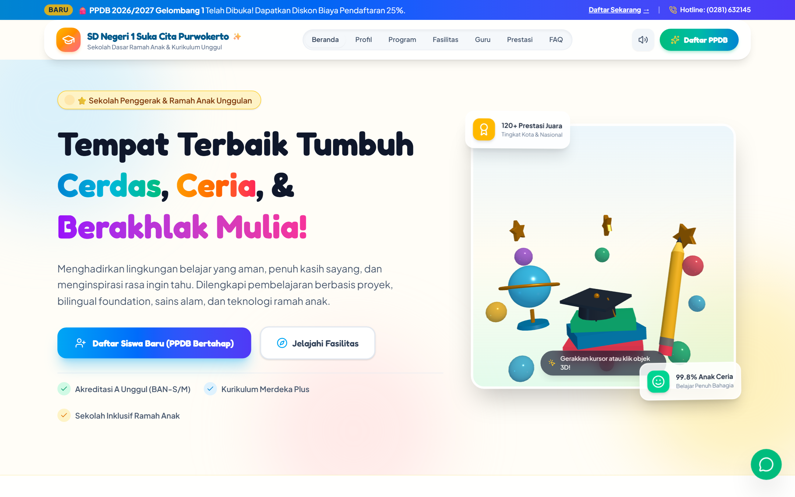
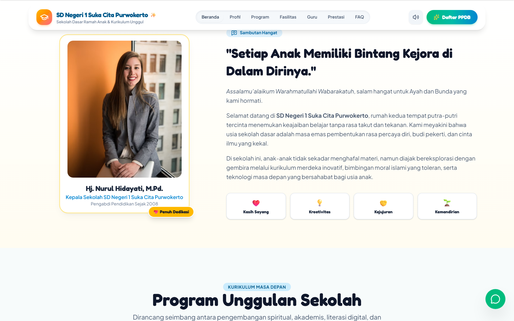
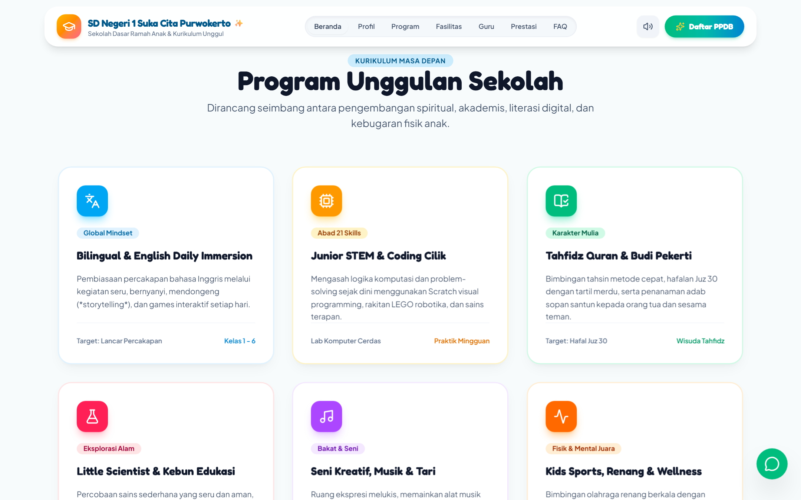
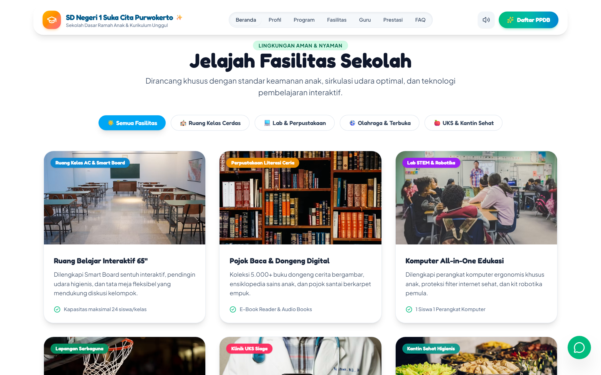
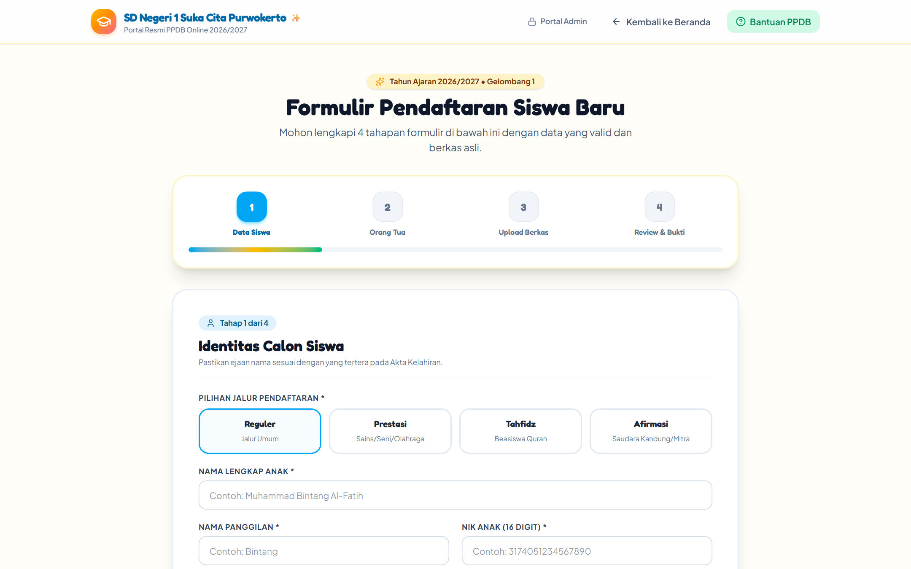
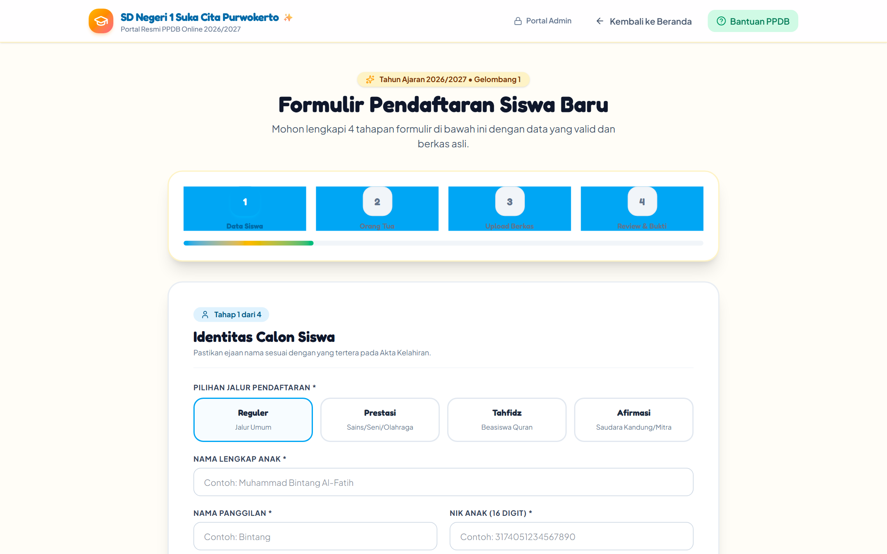
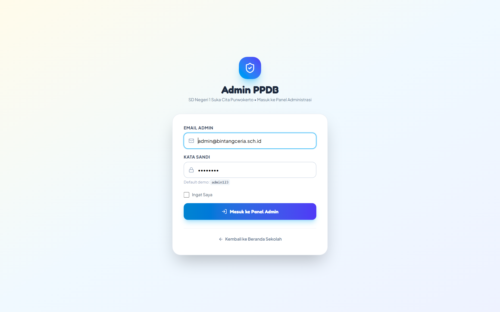
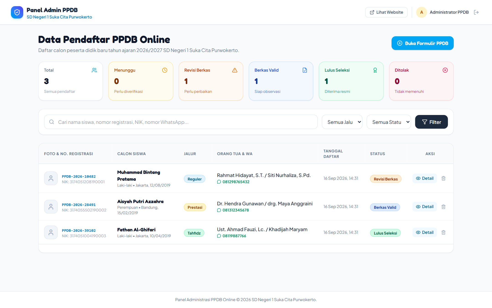
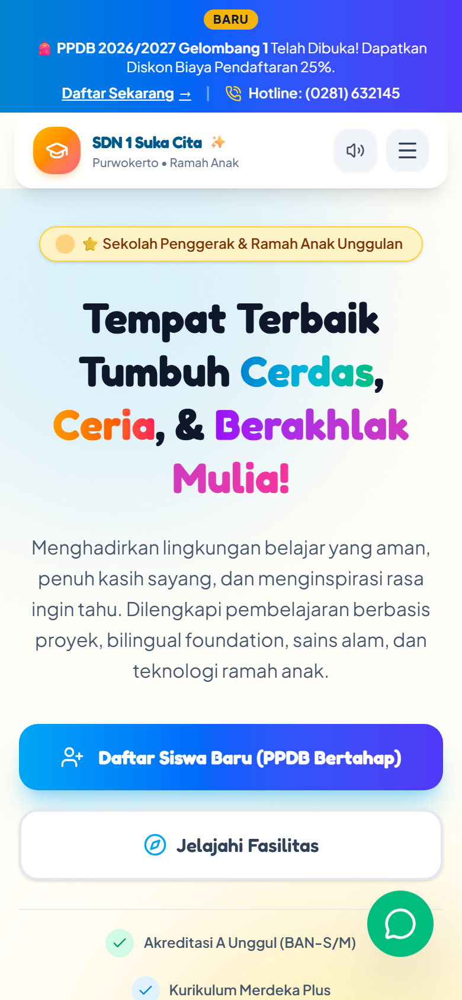
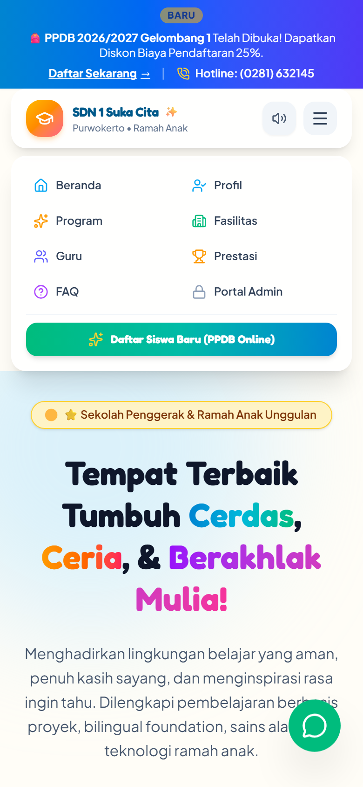

<p align="center">
  
</p>

<h1 align="center">🏫 Website Profil & Sistem PPDB Online<br>SD Negeri 1 Suka Cita Purwokerto</h1>

<p align="center">
  <strong>Platform Web Sekolah Dasar Modern, Ramah Anak, Interaktif 3D, dan Sistem Penerimaan Peserta Didik Baru (PPDB) Terintegrasi.</strong>
</p>

<p align="center">
  
  
  
  
  
</p>

---

## 🌟 Galeri Tampilan Aplikasi (Screenshots)

### 1. Landing Page Utama (Desktop View)
| Beranda & Hero 3D Interaktif | Sambutan Kepala Sekolah |
|---|---|
|  |  |

| Program Unggulan | Fasilitas & Prestasi Siswa |
|---|---|
|  |  |

---

### 2. Sistem PPDB Online (Formulir Bertahap / Multi-Step Wizard)
| Tahap 1: Pengisian Data Calon Siswa | Tahap 4: Unggah Berkas & Dokumen |
|---|---|
|  |  |

---

### 3. Panel Administrasi PPDB (Admin Dashboard)
| Halaman Login Admin | Dashboard & Manajemen Verifikasi Berkas |
|---|---|
|  |  |

---

### 4. Tampilan Responsif Ponsel (Mobile View)
| Tampilan Mobile Beranda | Navigasi Dropdown Mobile |
|---|---|
|  |  |

---

## ✨ Fitur-Fitur Unggulan

### 🎓 1. Antarmuka Landing Page Ceria & Ramah Anak
- **Animasi 3D Interaktif (Three.js)**: Animasi maskot pensil, bola dunia, topi toga, dan bintang kejora yang merespons interaksi kursor & sentuhan pengguna.
- **Efek Suara Interaktif (Web Audio API)**: Sound effect ceria saat tombol diklik, dengan opsi Toggle Mute/Unmute di navbar.
- **Navbar Adaptif & Responsif**: Navigasi bergaya pill-capsule yang rapi di layar desktop, tablet, maupun ponsel pintar.
- **Section Lengkap**:
  - Sambutan Kepala Sekolah dengan foto profil dan nilai-nilai inti.
  - Program Unggulan: Robotika Cilik, Bilingual Foundation, Tahfidz Al-Qur'an, dan Karakter Mulia.
  - Galeri Fasilitas Interaktif & Prestasi Juara.
  - Tanya Jawab Seputar PPDB (FAQ Accordion).
  - Peta Lokasi Kampus Purwokerto & Integrasi Floating WhatsApp.

### 📝 2. Sistem Pendaftaran Siswa Baru (PPDB Wizard)
- **Formulir Bertahap (Multi-Step 4 Langkah)**:
  1. *Identitas Calon Siswa* (Jalur Pendaftaran, Nama, NIK, TTL, Jenis Kelamin, Alamat).
  2. *Data Orang Tua / Wali* (Ayah, Ibu, Pekerjaan, Kontak WhatsApp).
  3. *Data Periodik & Kesehatan* (Tinggi/Berat Badan, Riwayat Imunisasi, Jarak ke Sekolah).
  4. *Unggah Berkas Digital* (Akta Kelahiran, Kartu Keluarga, Pas Foto, Ijazah TK, Sertifikat Prestasi).
- **Validasi Klien & Server Real-time**: Memastikan seluruh data valid sebelum dikirim.
- **Cetak Bukti Pendaftaran (PDF/Print Friendly)**: Nomor registrasi unik terbit otomatis (`PPDB-2026-XXXXX`) dan dapat langsung dicetak atau disimpan sebagai PDF.
- **Konfirmasi WhatsApp Otomatis**: Pesan WhatsApp terformat otomatis untuk konfirmasi ke panitia sekolah.

### 🛡️ 3. Panel Admin PPDB & Verifikasi Berkas
- **Autentikasi Aman**: Login berbasis proteksi sesi Laravel.
- **Statistik Pendaftar Real-time**: Indikator total pendaftar, status menunggu verifikasi, berkas valid, revisi berkas, lulus seleksi, dan ditolak.
- **Penyaringan & Pencarian Cepat**: Filter berdasarkan jalur pendaftaran, status seleksi, atau pencarian nama/NIK/nomor registrasi.
- **Fitur Status "Revisi Berkas"**: Verifikator dapat meminta perbaikan dokumen dengan menyertakan catatan kendala dokumen untuk wali murid.
- **Tautan Cepat WhatsApp Panitia**: Panitia dapat langsung menghubungi orang tua siswa dengan satu klik via WhatsApp.

---

## 🛠️ Teknologi & Stack yang Digunakan

- **Backend**: Laravel 13 (PHP 8.3)
- **Frontend**: Blade Templating, Tailwind CSS v4, Vanilla JavaScript
- **3D & Animasi**: Three.js, Canvas Confetti
- **Ikon**: Lucide Icons
- **Database**: MySQL
- **Tooling & Build**: Vite, NPM

---

## 🚀 Panduan Instalasi Lokal

### Prasyarat
- PHP >= 8.2
- Composer
- Node.js & NPM
- MySQL Server (Laragon / XAMPP)

### Langkah Pemasangan:

1. **Clone repositori:**
   ```bash
   git clone https://github.com/username/websitesekolahsd.git
   cd websitesekolahsd
   ```

2. **Pasang dependensi PHP & Node:**
   ```bash
   composer install
   npm install
   ```

3. **Konfigurasi Environment (`.env`):**
   ```bash
   cp .env.example .env
   php artisan key:generate
   ```
   Pastikan pengaturan database di `.env` sesuai dengan konfigurasi lokal Anda:
   ```env
   DB_CONNECTION=mysql
   DB_HOST=127.0.0.1
   DB_PORT=3306
   DB_DATABASE=websitesekolahsd
   DB_USERNAME=root
   DB_PASSWORD=
   ```

4. **Jalankan Migrasi & Database Seeder:**
   ```bash
   php artisan migrate --seed
   ```

5. **Hubungkan Storage untuk Berkas Unggahan:**
   ```bash
   php artisan storage:link
   ```

6. **Kompilasi Aset Frontend:**
   ```bash
   npm run build
   # atau untuk mode pengembangan:
   npm run dev
   ```

7. **Jalankan Server Lokal:**
   ```bash
   php artisan serve
   ```
   Buka browser dan akses: `http://127.0.0.1:8000`

---

## 🔑 Kredensial Akun Administrator

- **URL Login Admin**: `http://127.0.0.1:8000/admin/login`
- **Email**: `admin@bintangceria.sch.id`
- **Password**: `password`

---

## 🧪 Menjalankan Pengujian Otomatis

Proyek ini telah dilengkapi automated testing lengkap:
```bash
php artisan test
```

---

<p align="center">
  Dibuat dengan ❤️ untuk kemajuan pendidikan anak Indonesia.<br>
  <strong>SD Negeri 1 Suka Cita Purwokerto</strong>
</p>
